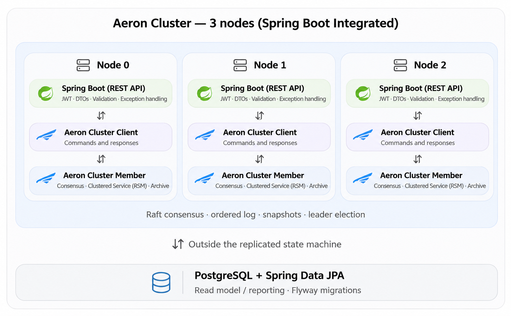
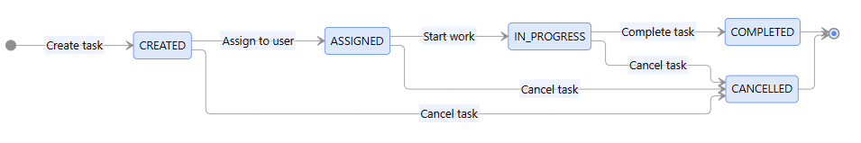

# EPAM Java Training Course: Smart Task Manager

The Java Course aims to revise Java and Spring framework knowledge. Besides, this repo will implement a simple poc of Replicated State Machine that uses [Aeron](https://github.com/aeron-io) for learning distributed system concepts like: Raft consensus, Leader election, Determinism replay, etc.

## Project Overview

User can:
- Create a task through `POST /tasks`.
- Update task status through `PATCH /tasks/{id}/status`.
- Retrieve a task through `GET /tasks/{id}`.
- Retrieve paginated tasks through `GET /tasks`.

The application can:
- Replicate its state across three  Aeron Cluster nodes.
- Elect new leader when current leader crashes by Raft consensus.
- Replay the data when any failure happens.

## Architecture Overview

## Task State Machine Diagram

## TODO list:
- [ ] Setup project: pom.xml, folder structure.
- [ ] Design domain entities, command types, interfaces.
- [ ] Implement Task State Machine in-memory.
- [ ] Implement REST APIs by Spring Boot.
- [ ] Implement authentication/authorization by Spring Security.
- [ ] Implement Docker, CI setup.